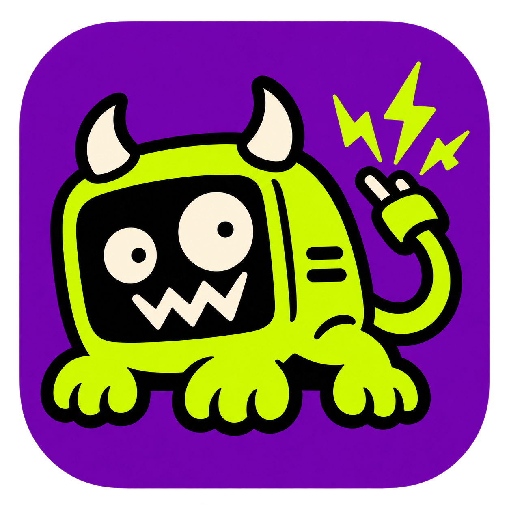
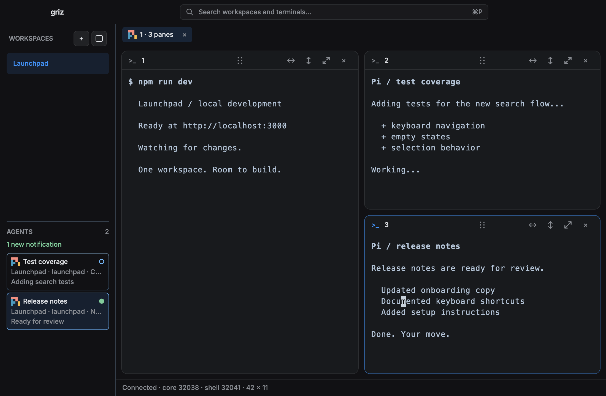

<p align="center">
  
</p>

<h1 align="center">Griz</h1>
<p align="center"><strong>Many terminals. One little gremlin.</strong></p>
<p align="center">A native macOS workspace for your shells, projects, and coding agents.</p>
<p align="center"><a href="#try-griz">Try Griz</a> · <a href="docs/GUIDE.md">User & developer guide</a> · <a href="docs/EARLY-TESTING.md">Early testing</a></p>



*Real Griz UI, shown with demo sessions and agent status reports.*

## Workspaces, split panes, and agent status

Keep development servers, shells, and coding agents in separate panes, grouped into workspaces and tabs. The Agents sidebar shows reported status across all workspaces, including panes you aren’t currently viewing.

- **Organize terminals.** Split a tab into up to eight panes, resize and rearrange them, or zoom a single pane.
- **Track agent status.** Working agents have a pulsing border. Completed agents have a solid border and a brief completion animation.
- **See unread alerts.** When an agent reports completion, a request for input, or an error, its card gets a filled dot and is included in the sidebar’s unread notification count. Click the card to open its exact terminal pane, or focus that pane yourself, to clear its unread alerts. Alerts for other panes stay unread. These are in-app indicators, not macOS notifications.
- **Search and switch terminals.** Press `⌘P` to search workspaces and terminals and preview a terminal before switching to it. Press `⇧⌘P` to find commands such as creating a terminal or changing the layout.
- **Reconnect to running sessions.** The terminal core runs separately from the GUI. Closing and reopening the window reconnects to sessions while that core is still running.

### Your agents, not another agent platform

Griz doesn’t replace your coding tools. It listens when they report their own status through [OSC 7501](https://www.superlogical.com/rex/docs/build/program-status). Current Pi supports this natively. Tools without that protocol still run as ordinary terminal programs, but Griz won’t guess their status from output or a process name.

## A few keys worth knowing

| Do this | Press this |
| --- | --- |
| Find a workspace or terminal | `⌘P` |
| Open the command palette | `⇧⌘P` |
| Split the current pane | `⌘D` / `⇧⌘D` |
| Zoom a pane in or out | `⌘Enter` |
| Open settings | `⌘,` |

## Try Griz

**Griz is early software for macOS.** Build from source on Apple Silicon or Intel. Expect rough edges and breaking changes, not a polished stable release yet.

You’ll need:

1. Rust/rustup and Xcode command-line tools.
2. A [Rune](https://github.com/anomalyco/rune) checkout next to this repository at `../rune`. The tested revision is `7256c7c2afb605862ccfe600a469df7330509efb`; Griz pins Rust 1.99.1 to match.

Then, from the Griz directory:

```sh
./scripts/dev.sh
```

The launcher fetches the official checksum-pinned libghostty-vt 1.0.0 XCFramework, builds both processes, and opens Griz. No Zig installation required.

**Already have running sessions?** Use the [isolated preview setup](docs/GUIDE.md#development) before testing changes. Restarting the core ends its terminals. Sessions survive closing the GUI, **not** a core crash or restart, logout, or reboot; disk-backed workspace restoration is not implemented.

## Dig deeper

- [User & developer guide](docs/GUIDE.md): agent reporting, settings, shortcuts, architecture, configuration, and current limitations.
- [Early testing guide](docs/EARLY-TESTING.md): sharing and trying a packaged Apple Silicon build, signing, and troubleshooting.
- [Checks and development tools](docs/GUIDE.md#check): tests, diagnostics, and offline previews.

Built with [Rune](https://github.com/anomalyco/rune) and [libghostty-vt](https://lib.ghostty.org/), with inspiration from Herdr Desktop and Rex. [Harness artwork credits](assets/harnesses/NOTICE.md).
